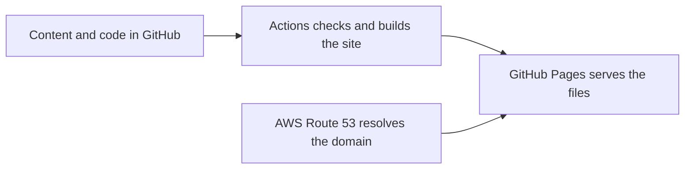

# Dantong Li

A static Astro website for GitHub Pages. Content stays in this repository. The domain stays in AWS Route 53.



## Edit content

| Change | File |
| --- | --- |
| Name, degree, contact links and skills | `src/data/profile.json` |
| Paper title, ordered authors, venue, links and BibTeX | `src/content/publications/*.md` |
| Exhibition order, short headlines and colours | `src/data/exhibition.json` |
| About composition | `src/pages/about.astro` |
| Portrait and other static files | `public/images/` |

The header links directly to Instagram and X. About opens the biography, with the contact and other account links beside its introduction. Instagram uses the stable local path `/instagram/`, which sends visitors to the `instagram` URL in `src/data/profile.json`. After an Instagram username change, update that one value and rebuild. The local path stays the same; it does not detect account renames automatically.

Keep the same paper IDs in the publication files and exhibition data. All six approved works have individual pages and downloadable citations. The excluded fidelity-divergence paper is not included. The old résumé PDF is kept at its former URL for compatibility; the website does not link to it as a current résumé. Replace it only after the separate résumé update is approved.

The home exhibition uses six related 3D mechanisms. Routing draws all sixteen modes as strands between their exact positions at the five stage boundaries of the pinned compiler's circuit; the drag moves stage by stage, and one strand is followed at a time. The generalized Hadamard view adds control qubits and joint readout factors for derivative orders one to three. The gate-cancellation circuit is an exact teaching example. The switch view shows coherent order histories and uses the stated one-qubit assumptions. Detection plus cancellation shows an operational concept. Transformer-QEC shows encoder context, positional queries, local proposals, residual decoding and the final XOR; it does not run a learned prediction. Each input changes a working part. There is no general spin control or shared interaction bar.

The home is one depth passage seen through a fixed, level camera. The active work sits at the front below its headline. Coming works wait smaller and farther back on the right; earlier works recede to the left. Both lanes converge behind the active work. Scrolling moves the works along these lanes and never changes a scientific value. At the start, the first work waits behind the portrait. At the end, the last work returns there and “Behind the work.” takes the reading position. Each settled reading state names the previous and next work under their objects as direct links. Wide, short screens use a story column with the work beside it.

Each paper page opens with its title beside its own mechanism: the same object met on the home passage, now in focus and directly operable. The route page links the exact compiler to its depth view in both directions. The PRL page also has a measurement atlas. The logical-qubit page keeps the paper’s reported Table II results; selecting them does not run a new simulation. Scope notes distinguish teaching calculations, concept diagrams and reported data. Finite animations show route traversal, local cancellation, added derivative controls and resized code inputs. Reduced motion settles these changes immediately. Labels sit on clear ground with short leaders, and readouts use intrinsic text flow.

## Run and check

Use Node 24.19.0 and pnpm 11.25.0, as pinned in `package.json`.

```sh
pnpm install --frozen-lockfile
pnpm dev
pnpm check
pnpm build
pnpm verify
pnpm preview
```

The build writes `dist/`. Run `verify` with the same environment values as `build`.

| Build setting | Default | Purpose |
| --- | --- | --- |
| `WEBSITE_ORIGIN` | `https://www.dantongli.com` | Canonical origin; no path |
| `WEBSITE_BASE` | `/` | `/` for the domain; `/repository-name/` for a project site |
| `WEBSITE_INDEXABLE` | `false` | Set to `true` only for the approved public build |

Preview builds include `noindex, nofollow` metadata and a blocking `robots.txt`. A production build with `WEBSITE_INDEXABLE=true` removes that metadata from normal pages and allows crawling. The 404 page and Instagram shortcut remain unindexed. These settings control indexing; they do not make a public preview private.

The validation workflow checks a domain preview, a project-path preview and an indexable domain build. It verifies all six papers, author order, source links, citations, local links, profile corrections and the indexing policy. Linux builds also create and verify the former mixed-case PRL and résumé URLs. Each downloadable validation artifact is one `.tar` file, with both spellings preserved inside it. Windows cannot create those case-only copies, so local Windows verification reports that limit. The GitHub Pages deployment action also packages the site as a TAR archive before upload.

Paper text, citations, sources and navigation work without JavaScript. The two larger computational tools load when requested, within the paper page. Reduced-motion users receive a static presentation. Keyboard and touch users can use the same page links and controls. Visual inspection at desktop and phone widths is still needed when changing layout or motion.

## Publish after review

No hosting or DNS change is performed by a local build. The included deployment workflow runs only when manually started.

`netlify.toml` provides temporary Astro settings for the existing Netlify branch and pull request previews: `dist/`, the pinned Node and pnpm versions, and disabled indexing. It requires a working repository connection. The legacy Netlify integration currently fails during GitHub SSH checkout with `Permission denied (publickey)`, before the build runs; this source does not change host credentials. The configuration skips production Git builds, and a second guard stops forced production builds before new files can be published. No new Netlify site is created. Remove this temporary configuration after the GitHub Pages cutover. See [Netlify deploy contexts](https://docs.netlify.com/build/configure-builds/file-based-configuration/) and [ignore-build rules](https://docs.netlify.com/build/configure-builds/ignore-builds/).

1. Put this folder at the root of the chosen GitHub repository. Preserve the existing site's repository and Netlify deployment until cutover is complete.
2. Set the repository's Pages source to **GitHub Actions**. Run **Publish website to GitHub Pages**, with indexing disabled, to check the hosted preview. The workflow reads the configured Pages address and uses its correct origin and project path.
3. After design approval, verify the custom domain in GitHub, set the Pages custom domain to `www.dantongli.com`, and update only the website records in Route 53 using GitHub's current domain instructions. Preserve email and other DNS records. Check the apex redirect, `www`, HTTPS, old PRL links and citations before removing the old host.
4. Run the workflow again with indexing enabled. Keep the prior DNS values for rollback. Automatic publishing on each push can be enabled after this first cutover.

The workflow uses the repository's `GITHUB_TOKEN`; no AWS credentials or personal access token belong in this source. GitHub may require one-time Pages or domain settings in the account. The workflows are prepared for GitHub Pages; a local check does not claim that a hosted workflow or deployment has run.

Official setup references: [custom GitHub Pages workflows](https://docs.github.com/en/pages/getting-started-with-github-pages/using-custom-workflows-with-github-pages), [custom domains](https://docs.github.com/en/pages/configuring-a-custom-domain-for-your-github-pages-site/managing-a-custom-domain-for-your-github-pages-site), [Pages metadata action](https://github.com/actions/configure-pages), [Node setup action](https://github.com/actions/setup-node).

## Order of the works

`src/data/exhibition.json` sets the order everywhere (home passage, All work, previous/next). The rule is: the latest work first, then the others by Google Scholar citations, highest first. Citation counts are only used to decide this order; they are not shown on the site. Each entry also names its `station`, the 3D model that represents it, so the order can change without touching the scene code.
