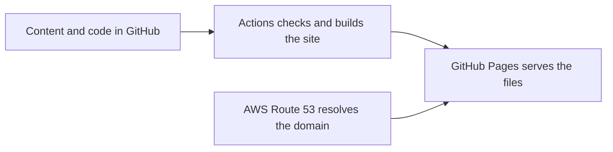

# Dantong Li

A static Astro website for GitHub Pages. Content stays in this repository. The domain stays in AWS Route 53.



## Edit content

| Change | File |
| --- | --- |
| Name, degree and contact links | `src/data/profile.json` |
| Paper title, ordered authors, venue, links and BibTeX | `src/content/publications/*.md` |
| Exhibition order, short headlines and colours | `src/data/exhibition.json` |
| About composition | `src/pages/about.astro` |
| Portrait and other static files | `public/images/` |

The slim header links to All work and About. About opens the biography, with email, Instagram, X and the other account links beside its introduction. About is a spread of two halves. The words (heading, introduction, Education, Outside research) fill the left half. The right half holds the portrait and, on the right margin, the motto 忘剑得神兵 as a vertical column in Zhi Mang Xing, a running-script brush font. Both start on the heading's cap line, and the portrait is as tall as the motto's ink. The portrait and the motto stay in view while the words scroll past. A wide frame crops the photo from the bottom, so the head stays whole; a narrow one keeps the helmet in the frame. On phones the motto alone stays in view, beside the heading, the portrait and the introduction, with the English in two short lines below it; the sections below take the full width. A phone held sideways (561–700px wide and less than 505px tall) keeps the two halves, so the whole motto fits on its screen. Before the cut, each character shows as a faint red print, like the red characters of a calligraphy copybook. The reader's scroll drives a sword down through the column: a black iron sword with a fret-framed window in its guard, a fang-like horn and a long slotted handle, wrapped in red qi. It was drawn for this site (`src/assets/motto-sword.svg`); its qi is painted in `public/images/motto-qi-*.webp`, one layer behind the iron and one in front, with smaller copies for phones. Each character opens behind the sword's point, and the English "Forget the sword; let true steel speak." appears one half at a time, beside 忘剑 and 得神兵 (on phones, below the column). Then the sword sinks away below 兵. The sword follows the scroll a little behind it and has a top speed, so a fast flick still takes about a second. The cut always ends while the head of the column is still on screen. Scrolling back brings the sword up again and closes the motto. A page with less than about 180px to scroll cuts once by itself, and the motto then stays open. If the brush font takes longer than 2.8 s, with reduced motion (also when it is switched on while the page is open) or without JavaScript, the motto and its translation are simply shown, without the sword. Screen readers hear the motto once, as one phrase. The font file `public/fonts/ZhiMangXing-Motto.woff2` contains only those five characters (SIL OFL 1.1, see `public/fonts/zhimangxing-OFL.txt`); a change to the motto needs a new subset of the font. About uses one type scale with a 3 : 2 ratio from the 16px body (16, 24, 36 for section headings, 54–81px for the heading, and the motto two steps above it (2.25×) when its column fits below the heading's cap line and the portrait beside it keeps a width of at least .45 of its height; otherwise as large as fits, but not below one step (1.5×) unless the screen is too short for that, and never taller than the screen; on phones the motto is the heading's size). Only the page label uses the site's 11px mono. Skills are not listed on the site. Instagram uses the stable local path `/instagram/`, which sends visitors to the `instagram` URL in `src/data/profile.json`. After an Instagram username change, update that one value and rebuild. The local path stays the same; it does not detect account renames automatically.

Keep the same paper IDs in the publication files and exhibition data. All six approved works have individual pages and downloadable citations. The excluded fidelity-divergence paper is not included. The old LinkedIn-export résumé PDF was removed at the owner's request in November 2026; its former address now shows the 404 page. A new résumé can be added later as a separate, approved change.

The home exhibition uses six related 3D mechanisms. Routing draws all sixteen modes as strands between their exact positions at the five stage boundaries of the pinned compiler's circuit; the drag moves stage by stage, and one strand is followed at a time. The generalized Hadamard view adds control qubits and joint readout factors for derivative orders one to three. The gate-cancellation circuit is an exact teaching example. The switch view shows coherent order histories and uses the stated one-qubit assumptions. Detection plus cancellation shows an operational concept. Transformer-QEC shows encoder context, positional queries, local proposals, residual decoding and the final XOR; it does not run a learned prediction. Each input changes a working part. There is no general spin control or shared interaction bar.

The home is one depth passage seen through a fixed, level camera. The active work sits at the front below its headline. Coming works wait smaller and farther back on the right; earlier works recede to the left. Both lanes converge behind the active work. Scrolling moves the works along these lanes and never changes a scientific value. At the start, the first work waits behind the portrait. At the end, the last work returns there and “Behind the work.” takes the reading position. Each settled reading state names the previous and next work under their objects as direct links. Wide, short screens use a story column with the work beside it.

Each paper page opens with its title beside its own mechanism: the same object met on the home passage, now in focus and directly operable. The route page links the exact compiler to its depth view in both directions. The PRL page also has a measurement atlas. The logical-qubit page keeps the paper’s reported Table II results; selecting them does not run a new simulation. Scope notes distinguish teaching calculations, concept diagrams and reported data. Finite animations show route traversal, local cancellation, added derivative controls and resized code inputs. Reduced motion settles these changes immediately. Labels sit on clear ground with short leaders, and readouts use intrinsic text flow.

## Run and check

Use Node 24.19.0 and pnpm 11.25.0, as pinned in `package.json`.

```sh
pnpm install --frozen-lockfile
pnpm dev
pnpm check
pnpm build
pnpm verify
pnpm preview
```

The build writes `dist/`. Run `verify` with the same environment values as `build`.

| Build setting | Default | Purpose |
| --- | --- | --- |
| `WEBSITE_ORIGIN` | `https://www.dantongli.com` | Canonical origin; no path |
| `WEBSITE_BASE` | `/` | `/` for the domain; `/repository-name/` for a project site |
| `WEBSITE_INDEXABLE` | `false` | Set to `true` only for the approved public build |

Preview builds include `noindex, nofollow` metadata and a blocking `robots.txt`. A production build with `WEBSITE_INDEXABLE=true` removes that metadata from normal pages and allows crawling. The 404 page and Instagram shortcut remain unindexed. These settings control indexing; they do not make a public preview private.

The validation workflow checks a domain preview, a project-path preview and an indexable domain build. It verifies all six papers, author order, source links, citations, local links, profile corrections and the indexing policy. Linux builds also create and verify the former mixed-case PRL URLs. Each downloadable validation artifact is one `.tar` file, with both spellings preserved inside it. Windows cannot create those case-only copies, so local Windows verification reports that limit. The GitHub Pages deployment action also packages the site as a TAR archive before upload.

Paper text, citations, sources and navigation work without JavaScript. The two larger computational tools load when requested, within the paper page. Reduced-motion users receive a static presentation. Keyboard and touch users can use the same page links and controls. Visual inspection at desktop and phone widths is still needed when changing layout or motion.

## Publish updates

GitHub Pages is configured for `www.dantongli.com`. AWS Route 53 manages the domain records. The first indexable release has been deployed. The migration and rollback records are kept outside this repository in `work/deployment/` in the project workspace.

Each push to `main` now runs **Publish website to GitHub Pages**. The workflow checks the source, builds and verifies the site, then publishes it with search indexing enabled. It reads the configured Pages address, so the origin and base path match the Pages settings. Changes on other branches do not trigger this publication workflow.

For a manual run, open the same workflow and choose whether to allow indexing. The optional `indexable` input defaults to `false`; leaving it off or selecting `false` creates an unindexed build. A manual run publishes to the same Pages site, so use `true` for a normal public release. Local builds keep their safe preview default and do not change hosting or DNS.

Keep the former Netlify deployment and the saved DNS values until the domain, HTTPS, apex redirect, legacy PRL links and citations have passed the live cutover checks. `netlify.toml` only allows the old service's branch and pull request previews; it blocks production Git builds. Retiring the old Netlify site and removing this temporary file are separate cleanup actions after the new host is verified. See [Netlify deploy contexts](https://docs.netlify.com/build/configure-builds/file-based-configuration/) and [ignore-build rules](https://docs.netlify.com/build/configure-builds/ignore-builds/).

The workflow uses the repository's `GITHUB_TOKEN`. AWS credentials and personal access tokens do not belong in this source. DNS changes are separate from routine content updates; preserve email and other unrelated DNS records.

Official setup references: [custom GitHub Pages workflows](https://docs.github.com/en/pages/getting-started-with-github-pages/using-custom-workflows-with-github-pages), [custom domains](https://docs.github.com/en/pages/configuring-a-custom-domain-for-your-github-pages-site/managing-a-custom-domain-for-your-github-pages-site), [Pages metadata action](https://github.com/actions/configure-pages), [Node setup action](https://github.com/actions/setup-node).

## Order of the works

`src/data/exhibition.json` sets the order everywhere (home passage, All work, previous/next). The rule is: the latest work first, then the others by Google Scholar citations, highest first. Citation counts are only used to decide this order; they are not shown on the site. Each entry also names its `station`, the 3D model that represents it, so the order can change without touching the scene code.
